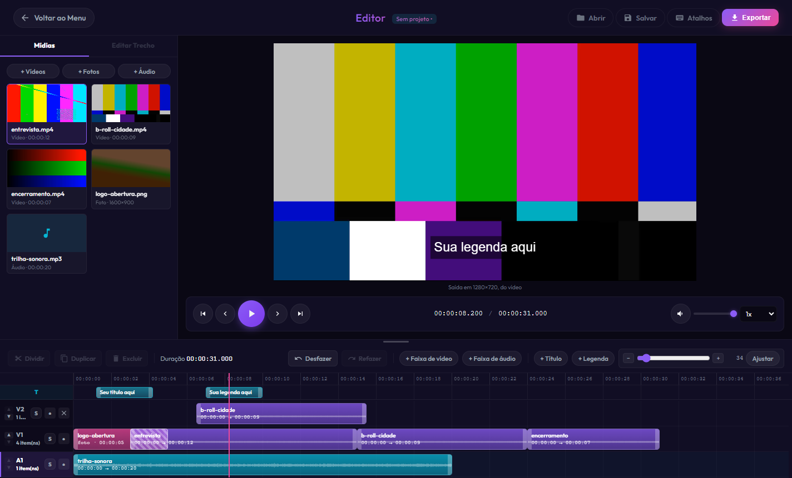
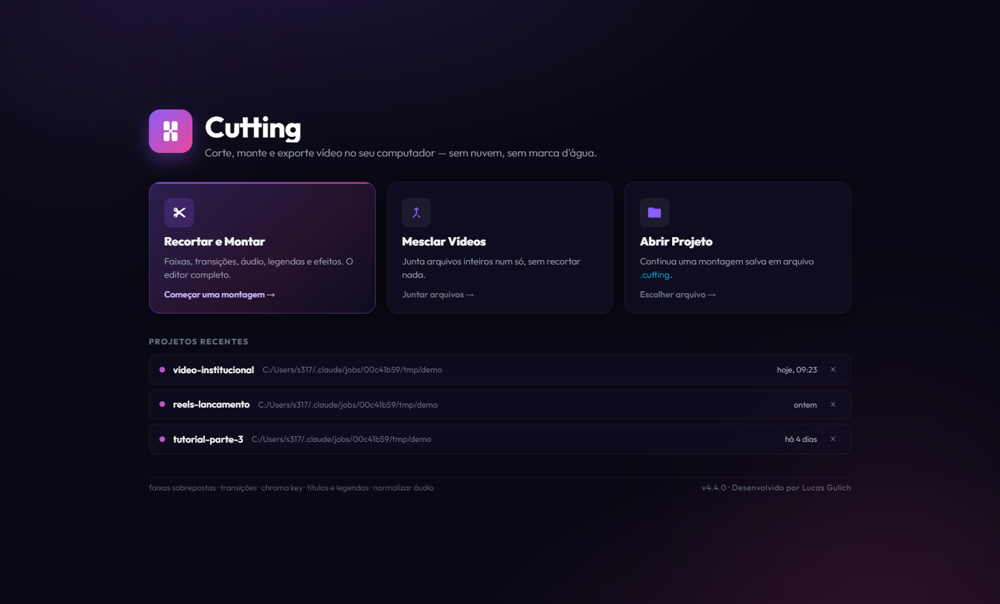
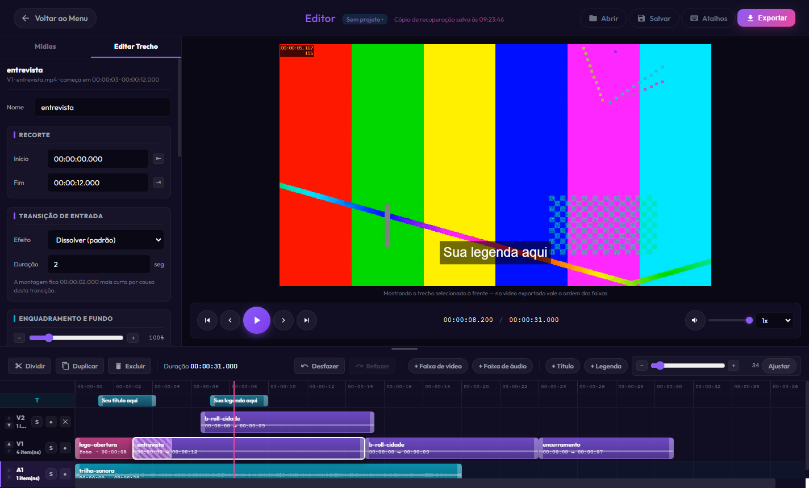
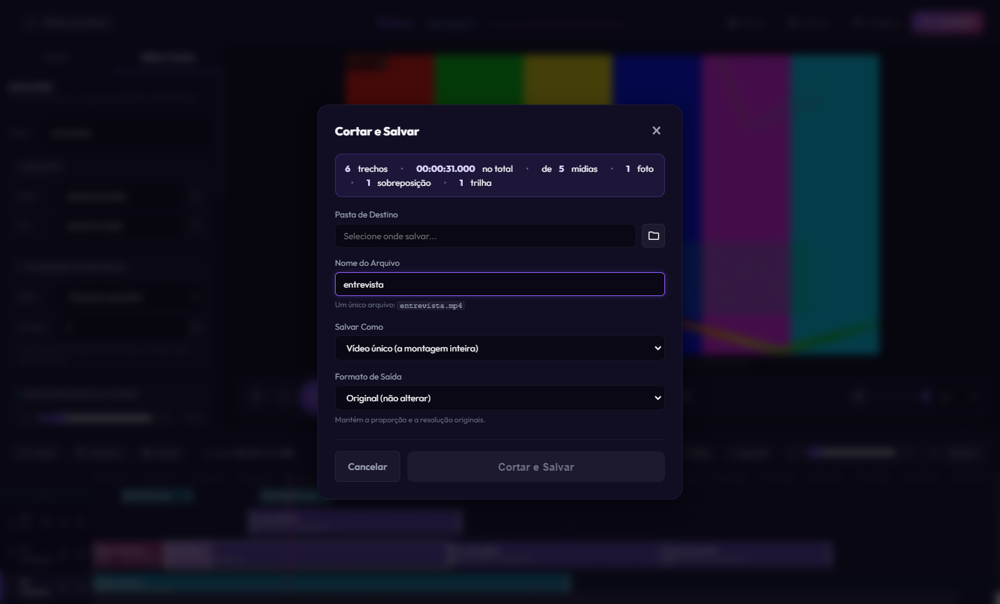
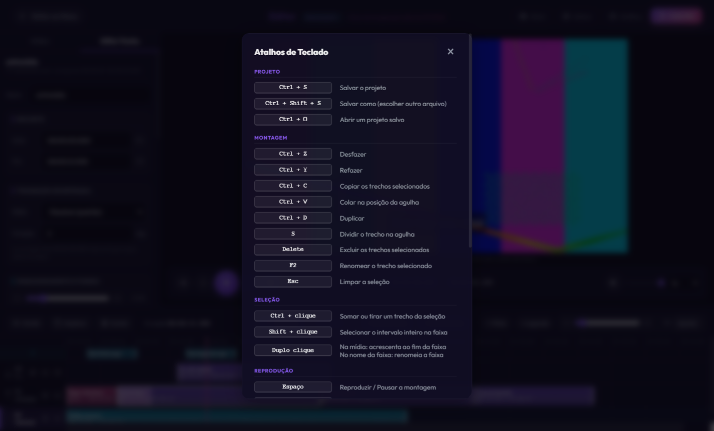
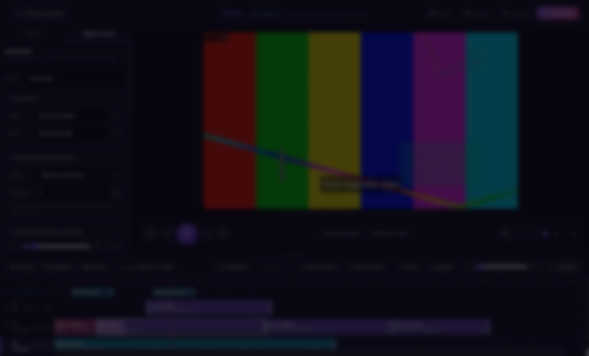

<div align="center">


# Cutting

**Editor de vídeo de mesa para Windows.**
Corta, monta em faixas, aplica transições, efeitos, títulos e trilha sonora — tudo na sua máquina, sem nuvem, sem conta e sem marca d'água.

[](#)
[](https://www.electronjs.org/)
[](https://ffmpeg.org/)
[](https://nodejs.org/)
[](#)
[](LICENSE)



</div>

Os binários do FFmpeg vêm embutidos: quem instala não precisa configurar nada.

---

## Índice

- [O que ele faz](#o-que-ele-faz)
- [Capturas de tela](#capturas-de-tela)
- [Como rodar](#como-rodar)
- [As três telas](#as-três-telas)
- [Fluxo de uso](#fluxo-de-uso)
- [Recursos em detalhe](#recursos-em-detalhe)
- [Exportação](#exportação)
- [Atalhos de teclado](#atalhos-de-teclado)
- [Projetos `.cutting`](#projetos-cutting)
- [Gerar o executável](#gerar-o-executável)
- [Testes](#testes)
- [Como o projeto é organizado](#como-o-projeto-é-organizado)
- [Solução de problemas](#solução-de-problemas)

---

## O que ele faz

- **Linha do tempo em faixas** — várias faixas de vídeo empilhadas (a de cima aparece na frente) e faixas de áudio separadas.
- **Corte preciso ao frame** — o início do trecho sai exatamente onde foi marcado, mesmo quando não cai num keyframe.
- **Transições** — 16 tipos (dissolver, cortina, deslizar, círculo, radial, pixelizar…), criadas ao sobrepor dois trechos vizinhos.
- **Fotos como trechos** — imagens entram na montagem com duração, zoom, reposicionamento e fundo (cor sólida ou a própria foto desfocada).
- **Efeitos por trecho** — velocidade (0,1× a 10×), opacidade, giro, espelhamento, brilho/contraste/saturação, chroma key e borrão de área.
- **Áudio** — onda sonora desenhada na faixa, volume por trecho, mudo, isolar faixa (solo) e normalização.
- **Títulos e legendas** — gravados no vídeo, com posição e tamanho em fração do quadro (o que se vê no monitor é o que sai no arquivo).
- **Formatos de saída** — original, 16:9, 9:16, 1:1, 4:5, 3:2 e 4:3, com ajuste *preencher* (corta as bordas) ou *encaixar* (tudo, com tarjas).
- **Mesclagem rápida** — tela separada para juntar arquivos inteiros, sem recortar nada.
- **Projetos e recuperação** — salva em `.cutting`, guarda projetos recentes e faz salvamento automático contra desligamento no meio do trabalho.
- **Desfazer/refazer, copiar/colar** e arrastar-e-soltar de arquivos.

---

## Capturas de tela

<table>
  <tr>
    <td width="50%">
      
      <p align="center"><sub><b>Início</b> — os três caminhos de entrada e os projetos recentes</sub></p>
    </td>
    <td width="50%">
      
      <p align="center"><sub><b>Editar trecho</b> — recorte, transição de entrada, enquadramento e efeitos</sub></p>
    </td>
  </tr>
  <tr>
    <td width="50%">
      
      <p align="center"><sub><b>Exportar</b> — vídeo único ou arquivos separados, em sete formatos</sub></p>
    </td>
    <td width="50%">
      
      <p align="center"><sub><b>Mesclar</b> — junta arquivos inteiros, sem recortar nada</sub></p>
    </td>
  </tr>
</table>

<details>
<summary><b>Atalhos de teclado dentro do app</b></summary>



</details>

---

## Como rodar

### Pré-requisitos

- **Node.js 18 ou superior** para rodar o app, e **22 ou superior** para rodar os testes ([nodejs.org](https://nodejs.org))
- **Windows 10 build 17763 ou superior, 64 bits**

Não é preciso instalar FFmpeg: ele vem junto pelas dependências `ffmpeg-static` e `@ffprobe-installer/ffprobe`.

### Passo a passo

```bash
git clone https://github.com/LucasGulich/Cutting.git
cd Cutting
npm install
npm start
```

`npm install` baixa cerca de 450 MB — a maior parte é o Electron e os binários do FFmpeg.

### Scripts disponíveis

| Comando | O que faz |
| --- | --- |
| `npm start` | Abre o aplicativo em modo de desenvolvimento |
| `npm test` | Roda toda a bateria: testes unitários, FFmpeg e interface (200 testes, ~20 s) |
| `npm run test:unit` | Só os testes puros (meio segundo) |
| `npm run test:integracao` | Só os de FFmpeg e Electron |
| `npm run dist` | Empacota o executável Windows em `dist/` |
| `npm run icone` | Regera os PNGs e o `icon.ico` em `build/` |

---

## As três telas

**Início** — os três caminhos de entrada: *Recortar e Montar* (o editor completo), *Mesclar Vídeos* (juntar arquivos inteiros) e *Abrir Projeto*. Embaixo, a lista de projetos recentes, que já indica quais ainda abrem.

**Edição** — o layout segue o padrão dos editores conhecidos:

```
┌ biblioteca ┬ monitor ─────────┐   em cima
├────────────┴──────────────────┤
│ ferramentas + linha do tempo  │   embaixo, largura toda
└───────────────────────────────┘
```

O monitor mostra a **montagem** na posição da agulha, não a mídia isolada.

**Mesclagem** — importa vários vídeos, define a ordem e junta num arquivo só.

---

## Fluxo de uso

1. **Importe** — botão de importar ou arraste vídeos, fotos e áudios para a janela. Eles entram na aba *Mídias*, na coluna da esquerda.
2. **Monte** — arraste da biblioteca para uma faixa da linha do tempo. Duplo clique na mídia acrescenta ao fim da faixa.
3. **Ajuste** — clique num trecho e use a aba *Editar Trecho*: recorte, enquadramento, velocidade, cor, chroma, áudio.
4. **Refine a linha do tempo** — arraste as bordas para aparar (gruda nas bordas vizinhas), sobreponha dois trechos para criar uma transição, `S` divide na agulha.
5. **Acrescente texto** — títulos e legendas ficam numa pista própria, com dois padrões prontos.
6. **Exporte** — escolha a pasta, o nome, vídeo único ou arquivos separados, e o formato de saída.

Detalhe importante das transições: como os dois trechos passam a ocupar o mesmo instante, **a montagem encurta** pelo tempo da transição. A linha do tempo mostra isso na hora.

---

## Recursos em detalhe

### Faixas e ordem de camadas

A faixa **mais acima aparece na frente** do vídeo exportado. Os botões ▲ ▼ mudam a ordem. Ao clicar num trecho, ele vem para a frente no monitor enquanto está selecionado — mas o arquivo exportado sempre segue a ordem das faixas.

### Enquadramento

Vale para foto e vídeo. `zoom` 1 encaixa a mídia inteira no quadro; abaixo disso sobra fundo, acima disso corta. Os deslocamentos são em fração do quadro, então o resultado é o mesmo em qualquer resolução. O fundo pode ser uma cor sólida ou a própria mídia desfocada.

### Efeitos por trecho

Todos entram na mesma cadeia, aplicada **antes** do enquadramento, nesta ordem — que é proposital:

1. **girar/espelhar** — muda a orientação, então vem antes de tudo que mede
2. **cor** — brilho, contraste e saturação sobre a imagem já orientada
3. **chroma key** — depois da cor, senão a correção mudaria o verde e a chave erraria o alvo
4. **borrão de área** — por último, para tapar o que ficou visível

A **velocidade** não entra nessa cadeia: ela mexe no tempo, não na imagem (`setpts` no vídeo, `atempo` no áudio).

### Áudio

A onda sonora é desenhada a partir de 1200 picos que cobrem a mídia inteira. Cada trecho tem volume próprio e pode ser mudo; cada faixa pode ser isolada com `S` (as outras ficam mudas). A normalização iguala o volume percebido entre trechos gravados em condições diferentes.

### Títulos e legendas

Texto não é mídia — não vem de arquivo nem tem recorte de origem —, então mora numa pista própria. Dois padrões:

- **Título** — grande, na parte de cima do centro, sem tarja, com contorno.
- **Legenda** — menor, embaixo, com tarja escura, que é o que a torna legível sobre qualquer imagem.

O texto é gravado no vídeo pelo filtro `drawtext`, e o conteúdo vai por arquivo em vez de inline — assim acento, dois-pontos, aspas, vírgula e quebra de linha entram exatamente como foram escritos.

---

## Exportação

### Vídeo único ou arquivos separados

- **Vídeo único** (padrão) — a montagem inteira num arquivo só.
- **Arquivos separados** — um arquivo por trecho da faixa base. Mesmo aqui a montagem é composta **primeiro** e recortada depois, então as faixas de cima, as trilhas de áudio e os textos vão junto.

### Formatos

| Formato | Resolução | Uso típico |
| --- | --- | --- |
| Original | — | Mantém a proporção e a resolução de cada vídeo |
| 16:9 | 1920×1080 | YouTube, Twitch, TVs, cursos, lives horizontais |
| 9:16 | 1080×1920 | TikTok, Reels, Shorts, Kwai |
| 1:1 | 1080×1080 | Feed do Instagram (clássico), Facebook, LinkedIn |
| 4:5 | 1080×1350 | Feed do Instagram — ocupa mais tela no celular |
| 3:2 | 1440×960 | Fotos e vídeos de DSLR, Pinterest, blogs |
| 4:3 | 1440×1080 | Vídeos antigos, iPad, apresentações |

Com um formato escolhido, o **Ajuste** decide entre *Preencher* (corta as bordas) e *Encaixar* (mostra tudo, com tarjas).

### Como o vídeo é gerado

O exportador escolhe o caminho conforme a montagem:

- **Montagem simples** (uma faixa de vídeo, sem sobreposição, efeitos ou texto) — quando os arquivos são compatíveis, a junção é feita **sem recodificar**, o que é praticamente instantâneo e não perde qualidade. Se os formatos divergem, ele padroniza.
- **Montagem composta** (várias faixas, transições, textos, trilhas) — sempre recodifica, porque compor camadas não permite cópia de streams. Acontece em duas etapas: primeiro a faixa base é normalizada e concatenada; depois, um único passe de `filter_complex` sobrepõe as camadas de cima e mixa o áudio.

Saída em H.264 (`libx264`, CRF 18, `yuv420p`) com áudio AAC 192 kbps a 44,1 kHz estéreo.

O corte é sempre **preciso ao frame**. Existe no backend um modo rápido, sem perda, que recua o início até o keyframe anterior — ele continua disponível na API interna (`exportClips` com `mode: 'fast'`), mas saiu da interface porque o desvio confundia mais do que ajudava.

Nomes de arquivo são higienizados e nunca sobrescrevem: se `meu_video.mp4` já existe, o próximo vira `meu_video (1).mp4`.

---

## Atalhos de teclado

Também disponíveis dentro do app, no botão de atalhos.

### Projeto
| Atalho | Ação |
| --- | --- |
| `Ctrl + S` | Salvar o projeto |
| `Ctrl + Shift + S` | Salvar como |
| `Ctrl + O` | Abrir um projeto salvo |

### Montagem
| Atalho | Ação |
| --- | --- |
| `Ctrl + Z` / `Ctrl + Y` | Desfazer / Refazer |
| `Ctrl + C` / `Ctrl + V` | Copiar os trechos / Colar na agulha |
| `Ctrl + D` | Duplicar |
| `S` | Dividir o trecho na agulha |
| `Delete` | Excluir os trechos selecionados |
| `F2` | Renomear o trecho |
| `Esc` | Limpar a seleção |

### Seleção
| Atalho | Ação |
| --- | --- |
| `Ctrl + clique` | Somar ou tirar um trecho da seleção |
| `Shift + clique` | Selecionar o intervalo inteiro na faixa |
| `Duplo clique` | Na mídia: acrescenta ao fim da faixa · No nome da faixa: renomeia |

### Reprodução
| Atalho | Ação |
| --- | --- |
| `Espaço` | Reproduzir / Pausar |
| `←` `→` | Um frame para trás / frente |
| `Shift + ←` `→` | 5 segundos para trás / frente |
| `Home` / `End` | Início / fim da montagem |
| `M` | Mudo no monitor |

### Linha do tempo
| Atalho | Ação |
| --- | --- |
| `Ctrl + roda` | Zoom da linha do tempo |
| Arrastar a régua | Mover a agulha |
| Arrastar a borda | Aparar o trecho (gruda nas bordas vizinhas) |
| Arrastar a divisória | Mudar a altura da linha do tempo (duplo clique volta ao padrão) |

---

## Projetos `.cutting`

Um projeto é um JSON que guarda a montagem e os **caminhos** das mídias — não as mídias em si. O arquivo fica pequeno, mas mover ou renomear um vídeo depois de salvar quebra o vínculo. Ao abrir, o app confere o que ainda está no lugar e avisa quais mídias sumiram, em vez de deixar você descobrir quando o vídeo não carrega.

**Recuperação automática:** enquanto você trabalha, o app grava uma cópia em `%APPDATA%/Cutting/recuperacao.cutting`. Ela fica na pasta de dados do aplicativo, não junto do projeto, para sobreviver a um desligamento sem poluir suas pastas. Fechar a janela com trabalho não salvo dispara uma confirmação, que oferece salvar antes de sair.

---

## Gerar o executável

```bash
npm run dist
```

Gera `dist/Cutting-win32-x64/` com o `Cutting.exe`. São cerca de 94 arquivos e ~690 MB.

O detalhe que faz isso funcionar: binários **não executam de dentro do `app.asar`**. O empacotamento usa `--asar.unpack` para deixar `ffmpeg-static` e `@ffprobe-installer` fora do pacote, e o código troca `app.asar` por `app.asar.unpacked` no caminho. Rodando pelo código-fonte não existe `app.asar` no caminho e a troca não faz nada — a mesma linha serve para os dois casos.

Para regerar os ícones:

```bash
npm run icone
```

O ícone da **janela** vem de `build/icon.ico` carregado em tempo de execução; o do **executável** é gravado dentro do `.exe` pelo `--icon` do electron-packager. São caminhos diferentes.

---

## Testes

```bash
npm test
```

São **200 testes em cerca de 20 segundos**, em três camadas:

| Camada | O que garante |
| --- | --- |
| **Unitária** (129) | As regras puras: cálculo de duração e volume, normalização dos ajustes, montagem dos filtros e do grafo de áudio, formato dos argumentos do FFmpeg, decisões da linha do tempo |
| **FFmpeg** (37) | O FFmpeg de verdade **aceita** cada filtro e grafo montado, e o arquivo que sai tem o codec, a duração e o volume esperados |
| **Electron** (33) | O app sobe, os handlers respondem e a interface funciona de ponta a ponta (separar áudio, salvar só áudio com a confirmação de 3 s), sem erro no console |

Os testes geram as próprias mídias sintéticas, rodam numa pasta temporária e **nunca tocam nos dados do app**. O corte, por exemplo, é validado por PSNR — compara o primeiro frame do arquivo cortado com o frame do original no tempo pedido, e também com o do segundo 0, para pegar o caso em que o vídeo saiu desde o começo.

**Toda funcionalidade nova entra com teste, e todo bug corrigido, com o teste que o teria pego.** O roteiro completo (o que testar em cada caso, padrões do projeto e o checklist de "pronto") está em [`docs/DESENVOLVIMENTO.md`](docs/DESENVOLVIMENTO.md) e [`docs/TESTES.md`](docs/TESTES.md).

---

## Como o projeto é organizado

| Arquivo | Papel |
| --- | --- |
| `main.js` | Processo principal: janela, diálogos e toda a orquestração do FFmpeg |
| `preload.js` | Ponte entre os dois processos, com `contextIsolation` ligado |
| `renderer.js` | A interface inteira: linha do tempo, monitor, painéis, atalhos |
| `index.html` | Estrutura das três telas e dos modais |
| `style.css` | Estilos |
| `lib/` | A lógica pura (filtros, montagem, áudio, regras da linha do tempo), sem Electron e sem tela, testada |
| `tests/` | Testes unitários (`unit/`) e de integração com FFmpeg e Electron (`integracao/`) |
| `test_backend.js` | Os 9 testes de integração originais do backend |
| `empacotar.cmd` / `executar.cmd` / `testar.cmd` | Gera o zip para enviar / abre para testar / roda os testes |
| `gerar-icone.js` / `empacotar-icone.js` | Geração dos PNGs e montagem do `.ico` |
| `diagnostico.bat` | Coleta informações numa máquina onde o executável não abre |

A segurança segue o padrão recomendado do Electron: `contextIsolation: true`, `nodeIntegration: false`, e o renderer só alcança o sistema pela superfície declarada no `preload.js`.

Sobre a escolha das dependências de FFmpeg: `ffmpeg-static` + `@ffprobe-installer/ffprobe`, ambos com builds de 2023. O `@ffmpeg-installer` está parado num build de 2018, que já foi a causa-raiz de um corte saindo errado (`-avoid_negative_ts` quebrando o `-t`) e não tem o filtro `xfade`, necessário para as transições. O par importa: ler com uma versão muito mais velha do que a que escreve é pedir para um metadado sair torto.

---

## Solução de problemas

**O executável não abre em outra máquina.** Coloque o `diagnostico.bat` dentro da pasta `Cutting-win32-x64` e rode. Ele gera um `diagnostico.txt` ao lado, com a versão do Windows, a checagem dos arquivos essenciais, o tamanho da pasta e a saída de uma tentativa de execução com log.

**Faltam arquivos / a pasta está bem menor que ~690 MB.** A cópia veio incompleta. Copie a pasta inteira de novo.

**Arquivos bloqueados pelo Windows.** Ao baixar em `.zip` ou `.rar`, o Windows marca os arquivos com `Zone.Identifier`. O diagnóstico aponta quais estão bloqueados; desbloqueie o compactado antes de extrair (Propriedades → Desbloquear).

**Windows antigo.** É preciso Windows 10 build 17763 ou superior, 64 bits.

**"Este arquivo não é um projeto do Cutting".** O `.cutting` está corrompido ou foi editado à mão. O app confere uma marca no JSON antes de carregar.

**Mídias sumidas ao abrir um projeto.** O projeto guarda caminhos, não as mídias. Se você moveu ou renomeou os arquivos, o app lista o que não encontrou ao abrir.

---

## Licença

ISC. © Lucas Gulich
